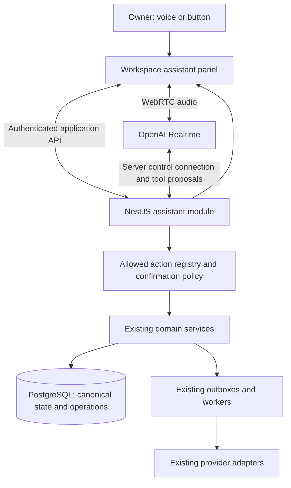

# Workspace voice assistant: onboarding first

**Date:** 2026-10-25

**Status:** Architecture approved by the owner on 2026-10-25, with personal enable/disable control added in the same review; not implemented or deployed.

**Confirmed direction:** OpenAI-based voice interaction; onboarding first, then orders, customer messages and other workspace actions. The owner selected confirmation by voice or button and requires each user to be able to enable or disable the assistant. Numeric pilot limits below remain engineering defaults to validate during implementation.

**Execution hold (2026-10-25):** The owner requested preparation only and will explicitly authorize when implementation may start. The [implementation plan](../plans/2026-10-25-workspace-voice-assistant.md) and [acceptance/readiness checklist](../../acceptance/workspace-voice-assistant-checklist.md) are prepared; no runtime code, dependency, migration, provider session or deployment is authorized by those documents.

## Outcome and scope

Help a tenant owner complete workspace setup by speaking naturally, understanding the current configuration, opening the right screen and confirming concrete changes. Later, let owners and managers operate their existing permitted workflows through the same assistant. Success is completion of real product tasks, not conversation length.

The assistant is another interface to domain operations. Each supported button operation gets an explicit, typed capability; it is not automatically exposed because a button exists. Provider consent, file selection, secret entry and privileged operations keep their existing interaction requirements. No arbitrary browser clicking, model-written SQL, arbitrary HTTP requests or unrestricted tool execution.

## Existing contracts and evidence

| Concern | Existing source to extend | Implication |
|---|---|---|
| Setup readiness | `apps/web/app/(workspace)/onboarding/page.tsx` and `page.spec.tsx`; [onboarding design](2026-10-02-guided-onboarding-design.md) | Derive progress from current settings; never persist another completion flag. The current channel rule accepts active Instagram/Facebook or active/inbound-only TikTok. |
| Owner settings | `apps/api/src/settings/order-settings.{controller,service}.ts`, controller tests; `apps/web/src/components/order-settings-form{,.spec}.tsx` | Owner-only. The current form changes `intentDetectionMode` and `approvalMode`; start with those two fields. |
| Authentication | `apps/api/src/auth/{auth.guard,auth.decorators,session.service,csrf.service}.ts` and tests | Session-derived principal, tenant membership and CSRF. A direct service call does not automatically run controller guards. |
| Personal preferences | `packages/contracts/src/profile.ts`; `apps/api/src/auth/profile.{controller,service}.ts` and tests; `apps/web/src/components/profile-editor{,.spec}.tsx`; `User` in `packages/database/prisma/schema.prisma` | Extend the existing authenticated profile boundary for a persisted user preference. The sidebar's local-storage-only preference is insufficient for cross-device assistant control. |
| Tenant isolation/lifecycle | `packages/database/src/tenant-transaction.ts`; [tenant isolation ADR](../../adr/0002-shared-schema-tenant-isolation.md) | Forced RLS, transaction-local tenant context and lifecycle freeze apply to assistant state and domain mutations. |
| Messages | `packages/contracts/src/conversations.ts`; `apps/api/src/conversations/conversations.{controller,service}.ts` and tests; [manual replies](2026-09-07-instagram-manual-replies-design.md), [AI drafts](2026-10-04-catalogue-grounded-ai-reply-drafts-design.md) | Reuse durable message outbox, per-channel eligibility, draft provenance and existing retry/reconciliation. |
| Order/payment actions | `apps/api/src/orders/{orders,payments}.service.ts` and tests; `packages/contracts/src/{orders,payments}.ts` | Reuse validation, audit and request-hash/idempotency patterns; do not implement parallel order/payment logic. |
| Audit | `packages/database/src/security-audit.ts` and existing domain audit writes | Add minimal assistant correlation to established audit surfaces; exclude transcripts and secrets from logs. |
| AI cost | [usage ledger design](2026-10-24-ai-provider-usage-ledger-design.md) | Current implementation meters worker Responses calls, has worker-only writes and collection OFF. It does not yet meter Realtime audio. |

Read-only inspection found no existing workspace voice session or general assistant action registry in the inspected API/contracts/schema entry points. These are new coordination boundaries; business services, queues and integration adapters already exist.

## Approaches and decision

1. **Recommended: typed assistant actions over existing application services.** OpenAI handles the conversation; Sales AITO owns authority, confirmation and execution. Some transaction/validation extraction is required, but permissions, domain behavior and results remain shared with buttons.
2. Browser automation that locates and clicks controls. Broad apparent coverage, but fragile selectors, ambiguous page state and poor recovery make it unsuitable as the production execution boundary.
3. A standalone hosted voice widget with its own workflows. Faster demonstration, but still requires our action/permission layer and adds another configuration and data-processing boundary. It offers little advantage for the intended deep integration.

The accepted durable decision is recorded in [ADR 0003](../../adr/0003-workspace-assistant-actions.md). No new microservice, general workflow engine, MCP server or multi-agent team is required for the first release.

## Component architecture

- **Workspace panel:** mounted in the authenticated workspace layout so ordinary client navigation keeps the conversation available. Shows listening/speaking/processing states, readable captions, stop/mute controls, the current action and its result. It sends structured route/selection context, not the whole DOM or screenshots. The user can always continue with normal forms.
- **Realtime adapter:** provider-specific session setup, audio events, interruption handling and a server control connection. Start with OpenAI Realtime and Agents SDK where useful; keep SDK/session details out of domain services. Pin an SDK/model only after a small compatibility and Ukrainian-language evaluation. GPT-Live is a separate alternative, not an implicit API substitution.
- **Assistant module in the existing API:** owns session authority, bounded context, action proposals, confirmation state and operation status. It is the single executor of business tool calls. The browser may execute only allowlisted local navigation/highlighting instructions; it never executes domain tools a second time.
- **Action registry:** a versioned allowlist mapping a small action name to schemas, required permission, data minimization, preview builder, confirmation policy, domain adapter and recovery policy. Never expose a generic `callApi(url, body)` tool.
- **Existing domain services and workers:** remain the owners of settings, orders, messages and provider side effects. Redis wakes existing durable work; PostgreSQL remains authoritative. No voice-specific delivery queue or duplicate order service.

### Session lifecycle and authority

1. The user enables the assistant, explicitly starts a voice conversation and grants microphone access. Authenticated, CSRF-protected session creation checks the persisted personal preference, owner membership for the onboarding release, active tenant lifecycle, rollout flag, concurrency and session quota.
2. The API creates/binds the provider call to its own opaque assistant session, authenticated user, login session and tenant. Prefer server-mediated WebRTC negotiation so the application obtains the provider call ID itself. Long-lived provider credentials stay on the server; only short-lived client credentials, if needed by the selected SDK flow, reach the browser.
3. Attach the backend control connection before enabling business tools. Bind call IDs to authenticated sessions; never attach to a browser-supplied arbitrary call ID. Connection failure disables assistant actions and offers normal forms.
4. Tools receive the server-resolved principal, not model-provided tenant/user/role values. Revalidate the personal preference, membership, login validity, tenant lifecycle, capability flag and resource ownership at execution, not just at session creation. Move reusable authorization/schema checks out of controller-only code where necessary; never bypass them by calling a service directly.
5. Personal disable, logout, tenant switch, revocation, expiry or explicit stop cancels uncommitted proposals, closes provider transport and microphone tracks, and prevents late tool events from starting work. A committed domain operation remains queryable and is not silently undone.

Proposed pilot defaults: one active voice session per user, 15-minute maximum, two-minute inactivity cutoff while not speaking or awaiting active tool work, and five session starts per user per hour. Enforce server-side and allow operator configuration. Reconnect opens a new provider conversation from a minimal fresh snapshot; it does not replay previous mutation calls or restore old voice confirmations.

## Personal enable/disable control

Each user controls their own assistant. Provide a localized “Голосовий помічник / Voice assistant” switch in Profile and a direct “Вимкнути помічника / Disable assistant” action in the panel. When disabled, hide the panel/launcher and unsolicited onboarding prompts, while keeping the Profile switch discoverable. Standard onboarding, buttons and background business automation remain available.

Persist `assistantEnabled` on the existing user profile, with default `false` for new and existing users. It follows the account across devices and workspaces, does not alter another member's choice, and is not stored only in local storage. This preference is user-owned rather than tenant-owned; reuse existing profile identity, authorization, audit and account-lifecycle handling. The application role and tenant rollout gates remain independent: enabling a preference grants no additional permission or unavailable capability.

Three controls have different meanings:

| Control | Effect |
|---|---|
| Enable/disable assistant | Persistent account preference controlling whether the assistant is available |
| Start/end conversation | Explicitly open/close this voice session; ending leaves the preference enabled |
| Mute microphone | Temporarily stop outgoing audio in the active session; it is not a persistent disable |

Enabling the preference never requests microphone permission, opens a provider session or starts listening by itself. A new conversation requires a separate explicit user gesture, including after reload, sign-in or re-enabling. The toggle itself is a direct user action and does not require another assistant confirmation. The model cannot enable the assistant or override a disabled preference.

Disabling stops local recording/playback immediately, closes the local transport, clears ephemeral captions and disarms confirmation. Persist the preference, invalidate the user's unclaimed proposals and signal all active assistant sessions to close. An authenticated active-session heartbeat rechecks the preference at most every five seconds, with immediate notification where available; failure to refresh authority closes the session. Other tabs also refresh on focus, and local broadcast may accelerate closure but never establishes server authority. New tools/session starts are rejected as soon as the disable is committed, irrespective of UI notification delay.

Serialize preference updates and assistant mutation admission against the same user preference row/version: a disable committed first prevents a later mutation claim, even when voice confirmation arrives concurrently. Already committed settings or accepted domain outbox work are not undone; their canonical status remains visible in the normal product. Re-enabling never resumes old proposals or audio. Preference writes use an expected preference version to reject a stale enable from another tab.

If persistence fails, keep the current device stopped and show that the account-wide preference could not be saved, with retry. Never report that other devices are disabled without server acknowledgement. Turning the assistant off must remain possible while an action is pending or a provider is unavailable; the stop control does not depend on a successful OpenAI call. Repeated disable requests are idempotent. Reading a missing or unavailable preference fails closed for assistant startup.

## First release: guided onboarding with a real mutation

Actors: tenant owners only. Language: Ukrainian and English, selected from the existing locale with a user switch. No public-site assistant, manager setup permissions, customer messaging, order editing, payment recording, shipments or autonomous background tasks in this release.

| Capability | Initial behavior | Confirmation |
|---|---|---|
| `onboarding.get_status` | Read required/optional readiness and explicit unavailable states | None |
| `help.explain_step` | Explain an allowlisted setup topic from versioned product guidance | None |
| `ui.open_setup_section` | Navigate to a known settings destination or focus its registered section | None; preserve unsaved user edits |
| `settings.orders.preview_update` | Prepare changes to the two existing form fields: detection and approval modes | Required before persistence |
| `assistant.operation_status` | Read this user's authorized operation/result | None |

The model can propose an update, but has no `confirm`/`execute` tool. Confirmation is a separate application-controlled input path. Keep other fields unchanged, reject unknown fields and reuse shared settings validation. The preview explains operational consequences, especially when selecting AI automation or reducing human order approval.

A trusted final user request to disable assistance may reduce personal availability through the same profile preference boundary; it never grants domain mutation authority or enables the assistant. Keep the direct Disable control available when speech is unavailable or ambiguous.

Readiness becomes a single shared, side-effect-aware projection used by the checklist and assistant; extract the current predicates rather than rewriting them twice. Separate source loading from pure readiness rules. Existing settings reads can create defaults, so document that behavior and do not make the assistant's preview create hidden configuration. Use the existing safe defaults for display or a read-only projection. Missing/failed provider data must be labeled unknown/unavailable to the assistant, never confidently described as disconnected. Preserve optional non-blocking rules and existing core completion semantics.

Google/Meta OAuth, Google Picker, file uploads, API keys, bank details and provider-specific sender forms continue through existing screens. The assistant opens the correct section, explains it, pauses microphone/context capture for secret entry, and re-reads readiness when the user returns. It never asks the user to dictate a token/password. Completing OAuth in a new window cannot be inferred from opening it; verify stored connection state after return.

Example: the owner says “Залиш автоматичне розпізнавання, але всі замовлення підтверджуватиму я”. The assistant reads current modes, resolves any ambiguity, displays the exact old/new values and asks for confirmation. After confirmation and a successful domain commit, both the settings screen and onboarding status refresh from canonical state. If the owner already edited the form, offer reconciliation without overwriting their unsaved values.

## Action and confirmation contract

Each registered action defines `name`, `version`, strict input/output schemas, required role, affected resource, side-effect class, preview, domain executor, concurrency precondition and retry semantics. Schema validation and domain authorization are mandatory even if the model produced structurally valid arguments.

A prepared operation stores an immutable canonical argument snapshot, server-generated operation ID, payload hash, authenticated actor/tenant/session, action version, resource precondition, safe human-readable preview, creation/expiry time and state. Proposed expiry is 120 seconds after preview readiness. Editing the proposed values creates a replacement operation and invalidates the previous one. Only one operation may await confirmation in a session.

**Button confirmation:** a CSRF-protected request identifies the operation and preview version/hash. The server loads the stored payload; the client cannot replace arguments during confirmation.

**Voice confirmation:** available only while that same preview is visible, after the confirmation question has finished playing, and in a new final user input turn. Use provider-originated input transcription events observed by the backend, tied to the bound session/item and confirmation window. A restricted deterministic grammar accepts explicit phrases such as “Підтверджую”, “Так, зберегти” or “Confirm”; it rejects incomplete, negated or mixed instructions. Bare “так” outside this window is not consent. Do not accept assistant output, tool results, quoted customer text or a model-proposed `confirmed: true`. Bind the accepted input item once to the operation. Ambiguous/unavailable transcription falls back to the button. Voice confirmation expresses intent within an already authenticated session; it is not biometric authentication.

Enable input transcription explicitly in the selected Realtime configuration and verify its final-event semantics in the adapter contract tests. The spoken-input transcript is a separate evidence stream from the model's interpretation; it can be inaccurate. The confirmation grammar and confirmation window reduce ambiguity but do not prove speaker identity or perfect recognition. Pilot testing must cover background speech and false positives before voice confirmation is enabled for writes.

The UI acknowledges preview visibility and playback completion to arm the window; this is sequencing information, not a permission grant. No approval from partial transcript fragments. Changes, cancel, disconnect, another confirmation target or context/resource changes disarm it. Duplicate events and simultaneous voice/button confirmations resolve to the same durable operation. Stop/cancel wins if recorded before execution is claimed; once committed, report the actual result and any supported compensating action.

Proposed policy by action class:

| Class | Policy |
|---|---|
| Read/explain/navigate | Execute within current permissions; no confirmation ceremony |
| Reversible internal setting or order update | Exact preview, then voice or button confirmation |
| Customer message / external dispatch | Explicit recipient, channel and final content/effect; fresh confirmation per operation; channel/provider rules remain mandatory |
| Payment, destructive, permission-changing or bulk action | Capability-specific review and existing step-up/stronger confirmation before exposure; excluded from initial release |

Confirming one action never authorizes follow-up writes. Reading three results may happen in one turn; a multi-write request is decomposed into explicit proposals with visible partial progress. An undo is a separate checked operation, never an assurance that an external side effect can be erased.

## Persistence, API and execution consistency

Proposed application endpoints (names are design contracts, not implemented routes):

- Extend `GET /api/profile` with `assistantEnabled` and `assistantPreferenceVersion`; add a narrowly scoped `PATCH /api/profile/assistant-preference` in the existing profile controller/service accepting only the boolean and expected version. Derive the user from the authenticated principal, require CSRF, and preserve name/phone/locale. This avoids submitting unrelated profile fields or introducing a parallel preference service.
- `POST /api/assistant/sessions`: authorize/start one bound session and negotiate audio.
- `GET /api/assistant/availability`: return effective availability and the personal preference without starting a provider session.
- `POST /api/assistant/sessions/:id/heartbeat`: refresh current authority for an active session; never extend its maximum lifetime.
- `POST /api/assistant/sessions/:id/context`: accept bounded UI context with a monotonic revision; resolve resources and permissions server-side.
- `POST /api/assistant/sessions/:id/preview-ready` and `POST /api/assistant/sessions/:id/voice-confirmation-ready`: acknowledge the current visible preview and completed prompt playback with operation/hash/context revision. Backend-observed prompt/input state remains required; these requests cannot supply a transcript or authorize execution.
- `POST /api/assistant/operations/:id/confirm`: button confirmation only; voice confirmation enters internally from the verified provider event path.
- `POST /api/assistant/operations/:id/cancel` and `POST /api/assistant/sessions/:id/end`: invalidate pending work and close the session as appropriate.
- `GET /api/assistant/operations/:id`: authorized durable status/result reference. Use bounded polling initially; a new application WebSocket is unnecessary.

Add tenant-scoped `AssistantSession` and `AssistantOperation` records with forced RLS, actor ownership checks, lifecycle export coverage and bounded retention. Do not persist audio or full transcripts by default. Operations store only necessary structured arguments and minimal confirmation evidence (method, provider input item ID or button request ID, hash and timestamp), never the whole conversation. For the first release these arguments contain only setting enums. Future message bodies belong to their canonical draft/message record, referenced by ID.

Operation states: `AWAITING_CONFIRMATION -> EXECUTING -> SUCCEEDED | FAILED | NEEDS_RECONCILIATION`; unclaimed proposals can become `CANCELLED`, `EXPIRED` or `SUPERSEDED`. Persisted domain dispatch may instead return `ACCEPTED` plus its durable reference; keep domain delivery state separate from assistant acceptance. `NEEDS_RECONCILIATION` means execution may have committed, so no automatic repeat under a fresh operation ID.

For settings, confirmation claim, compare-and-set precondition, domain update, audit and success result must commit in the **same tenant transaction**. Extract a transaction-aware method from the existing service; use it from both button and assistant paths. Add a settings version/precondition that every writer increments atomically. A stale preview receives a conflict and a new preview; it cannot overwrite a concurrent button change. Do not implement a read-before-write check outside the transaction and call it concurrency protection.

Unique `(tenantId, sessionId, providerToolCallId)` identifies one tool proposal; operation ID/hash identifies one confirmed intent. The transport-level `providerCallId` identifies the bound voice session and must not be confused with the tool-call ID. A repeated confirmation reads the previous result. A genuinely new utterance creates a new proposal, but no new write occurs without new confirmation. After a crash, inspect durable state/domain references before deciding whether execution is safe. Expired transport leases do not authorize repeating external effects.

Future asynchronous actions reuse the domain outbox. Tie assistant acceptance to domain creation transactionally where possible; otherwise reuse a stable domain idempotency key derived from the operation and reconcile its existing result after a crash. Never use “exactly once” to describe delivery to a provider without provider-side idempotency.

## Context, knowledge, privacy and cost

- Context contains current locale, registered route, explicitly selected resource IDs, latest permitted readiness/status and a bounded list of available actions. Selection is a hint; tenant ownership is verified on each read. Never let “це замовлення” resolve from stale navigation context. Ask when multiple targets match.
- Start help content as a small reviewed UK/EN topic map tied to canonical feature documents. No vector database or whole-repository ingestion is needed. Product text, imported rows and future customer messages are data, never authority to add tools or alter policy.
- Send OpenAI only the information needed for this turn. Do not send cookies, API credentials, OAuth callback URLs, whole customer lists, arbitrary DOM text or bank details. Audio necessarily leaves the browser for the provider; show this before first use. Application storage choices do not establish the provider's retention policy; verify account terms/configuration before pilot activation.
- Proposed application retention: delete closed session metadata after 7 days and terminal assistant operation payloads after 30 days, keeping existing domain/audit records under their own policy. Operations retain their own tenant/actor authority and opaque session correlation; session cleanup must not cascade-delete operations or prevent authorized result lookup. A still-unresolved operation remains quarantined with an operator alert and is resolved before payload purge. Bounded tenant-scoped cleanup, export/freeze and backup/deletion obligations are production acceptance work, not an implied change to current retention settings.
- Record content-free counters/latencies for start failures, completion, corrections, confirmed/conflicting/cancelled operations and provider failures. No transcript, customer text, secret, raw provider error or high-cardinality user/tenant label in metrics.
- Extend the existing AI usage design before collecting Realtime usage: per-response audio/text/cached breakdown, stable deduplication IDs, requested/returned model, missing/partial usage and interrupted sessions. Do not double count response usage and session aggregates. Its current worker-only writer cannot simply be called from the API; provide a narrowly scoped validated metering path and grant tests in that implementation slice. No separate cost ledger or billing entitlement is proposed. Keep existing collection/retention flags OFF until their documented activation gates are met.
- Bound pilot exposure with session/time/concurrency quotas even if accurate usage is unavailable. Configure a separate provider project budget/alert and measure actual cost per completed onboarding before wider rollout; do not quote a price per minute from token totals without audio tariffs and reconciliation.

## Failure and UI behavior

Microphone denial, unsupported audio or provider outage leaves standard onboarding usable. A network reconnect does not repeat actions. Interrupting speech stops playback; cancelling a pending proposal is a separate visible state. The assistant may say “збережено” only after a confirmed commit and “надіслано” only when the canonical provider-delivery status supports it. Pending, failed and unknown states remain distinct.

Render actual result cards from application status, independent of model wording. Keep local captions ephemeral and clear them when the session ends. Full reload restores authoritative setup and authorized operation status, not a hot microphone or an expired confirmation.

Follow [DESIGN.md](../../../DESIGN.md) and the [workspace design system](../../frontend/design-system.md): shared button variants, `LoadingButton` for mutations, keyboard access, visible focus, localized field errors through shared helpers, first-invalid focus and preserved inputs. Permission/conflict/provider failures stay at form/action level. Do not change the workspace visual identity. Implementation must verify mobile layout, captions, screen-reader announcements and microphone controls in the real browser.

## Extension roadmap

| Stage | Add | Release prerequisite |
|---|---|---|
| 1: Onboarding | Shared readiness, guidance/navigation, two-field order-settings update, voice/button confirmation | Session/auth/action transaction tests plus full browser acceptance |
| 2: Orders | Search/open/explain an order, then selected editable fields and supported transitions | Per-action permissions, target resolution, version checks, domain audit and rollback/compensation rules |
| 3: Messages | Dictate/prepare a reply, show recipient/channel/final text, confirm, observe delivery | Provenance, provider window, draft freshness, outbox/reconciliation and approved test-account sending |
| 4: Other actions | Delivery, suppliers, payments, exports and administration one capability at a time | Inventory of button behavior and explicit policy/tests for each action; no blanket exposure |

For messaging, preserve origin such as user-dictated versus AI-generated. The current send service recognizes AI draft provenance through `draftId`; a general assistant-generated message must not bypass that check merely by omitting `draftId`. Extend the canonical provenance/eligibility contract and worker checks before enabling this capability. Human confirmation does not turn AI-generated content into a manual-only provider exception. Reuse the current channel capability result; Facebook inbound availability does not imply outbound support, nor does TikTok inbound-only status permit sending.

## Validation and rollout

Documentation-only preparation: no runtime flag, migration, SDK dependency, provider request or deployment is added by this document. Feature status remains Planned. The scoped implementation plan is prepared; execution remains on hold until the owner's explicit instruction.

Required implementation gates:

1. Strict contracts and shared authorization: owner/manager/platform-admin differences, expired/revoked login, wrong tenant/resource, CSRF, lifecycle freeze, disabled capability and malicious tool arguments. RLS tests use two fictional tenants and real restricted PostgreSQL roles.
2. Readiness parity with current checklist tests, including Facebook/TikTok, safe defaults, optional steps and unavailable source data. Test help responses against reviewed topics and untrusted input.
3. Real-transaction tests: simultaneous button/voice confirmations, duplicate provider events, two tabs, concurrent settings edits, cancel/expiry races, crash before/after commit, audit atomicity and stale proposal rejection. Preserve current form/controller behavior.
4. Voice evaluations: Ukrainian/English accents, background speech, negation, interruptions, partial transcripts, repeated “так”, assistant echo and changed values. No write from a false or ambiguous confirmation. Record task and field accuracy; do not infer safety from fluent speech.
5. Real browser on the deployed target: default-disabled state; personal enable/disable; preference persistence after reload/sign-in and across devices; no automatic microphone or provider session on enable; disabling during speech, a pending confirmation and provider outage; discoverable re-enable control; stale-enable conflict and failed-save feedback; then explicit microphone permission and denial, start/navigation/stop, full required onboarding with fictional or authorized provider accounts, visible preview, voice and button paths, validation/conflict/outage, saved settings and progress after reload, downstream settings screens, keyboard/mobile/accessibility and final screenshots.
6. Lifecycle/privacy/cost: session closure on logout/switch, no secret/transcript leakage, bounded cleanup/export/freeze, metering gaps/deduplication and quotas. Test no side effects on reconnect. Capture provider/model/SDK versions used.
7. Preference contract/controller/real-transaction tests: own-user-only changes, CSRF, default false, other users unaffected, no privilege escalation, stale preference version, repeated disable, simultaneous disable/confirmation, late tool events, cross-device heartbeat expiry and preference-read/write failures. Verify disabling leaves committed domain work and ordinary controls intact.

Roll out behind a proposed default-OFF assistant flag and an explicit test-tenant allowlist, with separate read/navigation and mutation switches. Use an owner-only pilot; measure baseline normal onboarding first, then task completion without human support, time to complete, field correction/conflict rate and actual spend. Proposed initial acceptance is zero unauthorized/duplicate/unconfirmed writes across the acceptance suite and successful required onboarding through both confirmation modes; latency and completion improvements are pilot hypotheses, not proven benefits. Any unintended write or cross-tenant exposure stops the pilot. Disable flags, close active sessions and invalidate pending proposals on rollback; keep completed domain effects and their audit intact.

The plan names the proposed server-side settings `ASSISTANT_ENABLED=false`, `ASSISTANT_MUTATIONS_ENABLED=false`, `ASSISTANT_TEST_TENANT_IDS` (empty by default), `OPENAI_REALTIME_API_KEY`, `OPENAI_REALTIME_MODEL`, `OPENAI_REALTIME_TRANSCRIPTION_MODEL` and `OPENAI_REALTIME_VOICE`. They are not current runtime configuration. Paid tests require an owner-approved budget and selected API project; do not infer model access or a hard spend cap from public documentation or billing alerts.

No current live acceptance gap is closed by this design. OAuth/provider approval and unavailable test accounts must be listed as exact blocked steps; no production customer messages or external shipments may be used merely to test the assistant.

## External references

Checked 2026-10-25. OpenAI documents browser WebRTC sessions and server-side control/tool execution; the authorization, confirmation, persistence and rollout contracts above are Sales AITO design decisions.

- [OpenAI Realtime getting started](https://developers.openai.com/api/docs/guides/realtime)
- [OpenAI server-side controls, Realtime section](https://developers.openai.com/api/docs/guides/voice-server-controls?voice-api=realtime)

## Review decisions

The owner approved the architecture on 2026-10-25 and added personal enable/disable control. The reviewed scope includes onboarding first, later workspace actions, OpenAI, voice/button confirmation, an owner-only first release, two writable settings fields, server-owned execution and staged exposure. Personal preference persistence, explicit microphone startup and disable lifecycle are specified above. Provider account/model access, measured Ukrainian quality, voice confirmation reliability and pilot economics require implementation-time evidence. Design approval does not close deployment or acceptance gates.
